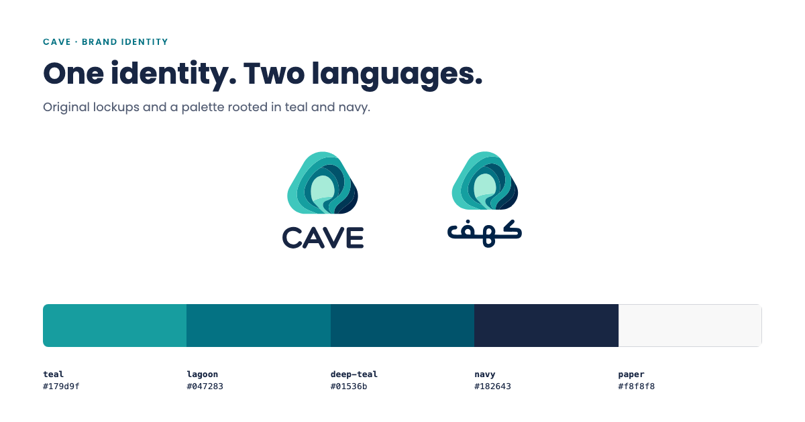

<p align="center">
  <picture>
    <source media="(prefers-color-scheme: dark)" srcset="assets/logos/cave-symbol-white.svg">
    
  </picture>
</p>

<h1 align="center">Cave Brand</h1>

<p align="center"><strong>The Cave identity, with the rules that keep it consistent.</strong></p>

<p align="center">
  
  
  
</p>

<p align="center">
  <a href="https://brand.cave.technology">Brand guide</a> · <a href="#the-brand-kit">Brand kit</a> · <a href="#get-started">Get started</a> · <a href="#usage-and-licensing">Usage and licensing</a> · <a href="#maintainer-reference">Maintainer reference</a>
</p>

---

The official Cave logo, symbol, icons, patterns and colours, presented in a bilingual static website. Use the guide to choose the right asset and understand its permitted use. Interface components and design tokens live in the separate [Cave Design System](https://github.com/Shmaisanymostafa/Cave-Design-System).



<sub>Documentation composition of the original, unmodified lockups and verified palette values. [Artwork provenance](docs/readme-assets/NOTICE.md).</sub>

## The brand kit

| Resource | What you will find |
| --- | --- |
| **Logos and symbol** | English and Arabic lockups, full-colour originals and white reversals |
| **Icons and patterns** | Cave, layers and river icons; outline, layers and dots patterns |
| **Desktop wallpapers** | Cave Horizon and Cave Flow, original 1916 × 821 PNGs (approximately 21:9), available in the site’s wallpaper section |
| **Usage guidance** | Approved backgrounds, naming, colour values, typography and licensing |
| **Bilingual website** | English at `/` and Arabic at `/ar/`; System, Light, Dark and Black appearance choices |

[Download the kit](kit/cave-brand-kit.zip) · [Browse logos](assets/logos) · [Browse icons](assets/icons) · [Browse patterns](assets/patterns)

## Get started

The site is plain static files: no dependency installation or build step is required.

```sh
python3 -m http.server 8080 --bind 127.0.0.1
```

Open `http://127.0.0.1:8080/` for English or `http://127.0.0.1:8080/ar/` for Arabic (in production the Arabic page is `/ar`, without a trailing slash). Run the server from the repository root so asset URLs resolve correctly.

## Usage and licensing

**Cave brand assets are proprietary and are not open source.** The name, logo, symbol, wordmark, icons and patterns belong to Cave. The kit's `LICENSE.txt` and the website's [licence section](https://brand.cave.technology/#licence) define the terms.

The existing terms allow unmodified logo files to refer to Cave in press, partner or integration pages, and a “Powered by Cave” credit. Other uses, including a modified logo or using it as your own brand, require written permission from `info@cave.technology`. Do not recolour, redraw, retype, stretch or add effects to the mark, or imply Cave endorsement.

Poppins and Almarai retain their SIL OFL terms. Hero and Blue Ocean are licensed to Cave and are not distributed in the kit. The design system's MIT package licence does **not** cover Cave marks or proprietary fonts.

## Maintainer reference

<details>
<summary><strong>Repository map, site tools, asset maintenance and hosting</strong></summary>

### Repository map

| Location | Purpose |
| --- | --- |
| `index.html` · `ar/index.html` | Hand-edited pages; keep both languages in step |
| `assets/logos/` · `assets/icons/` · `assets/patterns/` | Original SVG artwork |
| `assets/css/tokens.css` · `assets/css/components.css` | Copies of design-system output (`tokens.json` and `source/components/bundle.css`); refresh with `node scripts/sync-from-design.mjs`, verify with `--check` |
| `scripts/` | Maintainer tools; excluded from hosting |
| `assets/css/brand.css` · `assets/css/fonts.css` | Brand-site styling and typography |
| `assets/js/` | Theme selection and brand tools |
| `kit/cave-brand-kit.zip` | Downloadable assets with `LICENSE.txt` |

### Appearance and asset tools

The theme picker stores `cave-brand-theme` locally and shares it across language pages and tabs. System follows device changes. If storage is unavailable, switching still works for the current page. `assets/js/theme.js` applies the saved choice before styles load, including on the 404 page.

Committed site tools provide approved background previews, transparent 1600px PNG export from the original SVG, and copy-colour controls with a manual fallback. Export preserves original proportions and omits the preview background. These source capabilities do not establish the currently deployed revision.

### Asset maintenance

`assets/wallpapers/` contains the approved original Cave Horizon and Cave Flow PNGs. The English and Arabic wallpaper sections preview and download these same files without resizing or adding a logo. Both are 1916 × 821 pixels (approximately 21:9). They are website downloads, separate from the logo-and-pattern brand kit.

Keep the supplied SVGs unchanged. When an authorized asset changes, rebuild the kit with the three asset folders and its existing licence text inside `cave-brand-kit/`. Fonts are not offered as part of the kit.

`Hero.otf` is intentionally absent from Git because no redistribution licence is provided, and `firebase.json` excludes `assets/fonts/Hero.*` from every deploy so a local copy can never be published; production headings use Poppins (a missing Hero file is a harmless 404 on the font request). Only use a separately licensed local copy when authorized. The old letterhead images and presentation PDF remain excluded because they contain retired information. Product icons are not part of this kit.

### Hosting

`firebase.json` serves the repository directly. The configured Firebase project and Hosting site are `cave-brand-kit`; the custom domain is `brand.cave.technology`. Responses carry a Content-Security-Policy (scripts, fonts and images from this origin only; inline styles allowed for the few `style` attributes). Deployment requires separate owner approval. This documentation change does not deploy the website.

</details>

[Design system](https://design.cave.technology) · [Cave Shops](https://shops.cave.technology)
